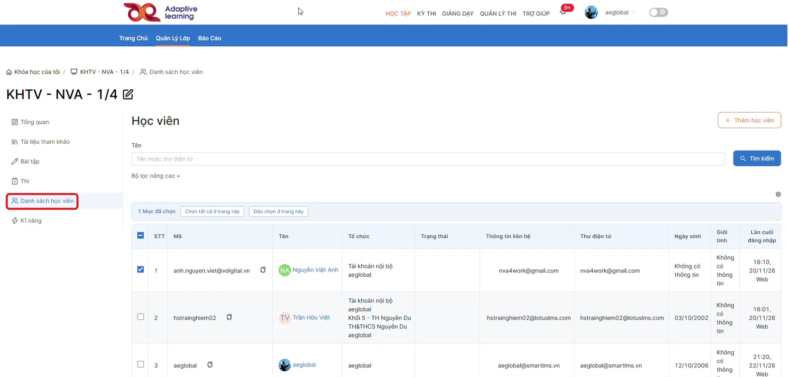
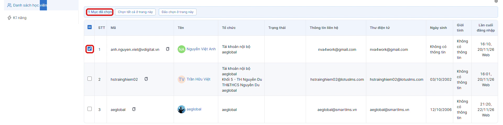
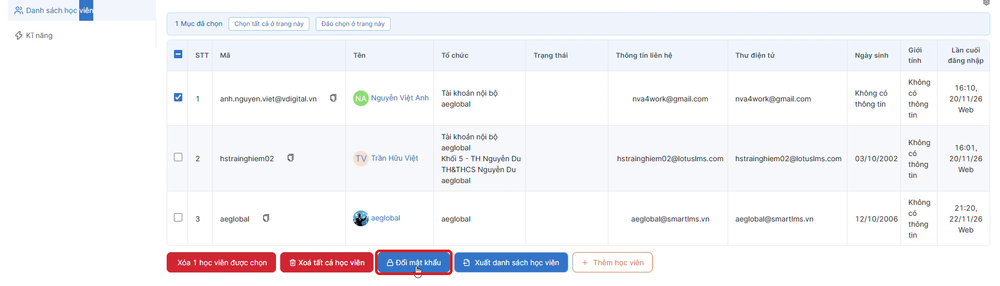
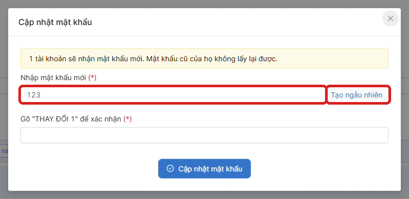
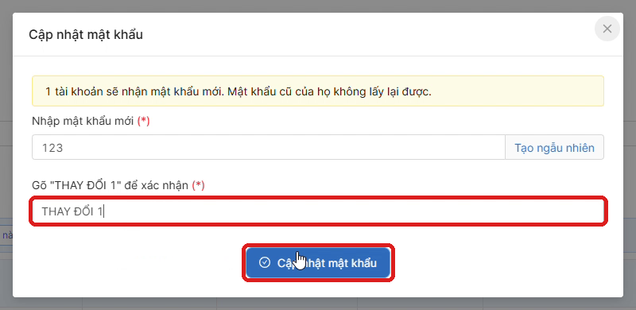
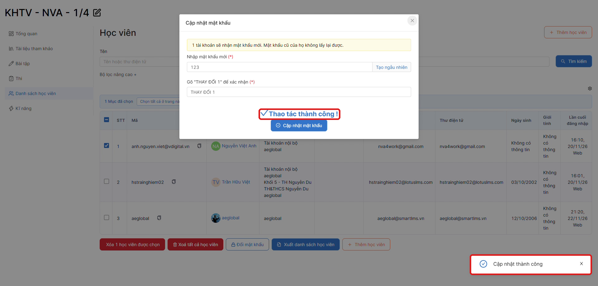

Giáo viên quản lý lớp có thể đặt lại mật khẩu cho một hoặc nhiều học sinh ngay trong trang Danh sách học viên của lớp, chỉ qua 6 bước. Tài liệu này dùng cho giáo viên và quản trị lớp trên hệ thống  khi học sinh quên mật khẩu.

## Bước 1. Mở khóa học và vào Danh sách học viên

1. Truy cập vào giao diện Khóa học
2. Ở menu bên trái của lớp, bấm **Danh sách học viên**.

Màn hình hiển thị bảng Học viên gồm mã, tên, tổ chức, email và lần đăng nhập cuối của từng học sinh.

## Bước 2. Chọn học sinh cần đổi mật khẩu

Tích vào ô vuông đầu dòng của học sinh cần đổi mật khẩu. Dòng **"1 Mục đã chọn"** phía trên bảng cho biết số tài khoản đang được chọn.

- Đổi cho nhiều học sinh cùng lúc: tích nhiều ô, hoặc bấm **Chọn tất cả ở trang này**.
- Chọn nhầm: bỏ tích ô đó, hoặc bấm **Đảo chọn ở trang này**.
- Lớp đông học sinh: gõ tên hoặc email vào ô **Tên** rồi bấm **Tìm kiếm** để lọc trước khi tích chọn.

## Bước 3. Bấm nút Đổi mật khẩu

Sau khi chọn học sinh, thanh nút thao tác xuất hiện ngay dưới bảng. Bấm nút màu xanh **Đổi mật khẩu** (biểu tượng ổ khóa).

Cẩn thận: hai nút màu đỏ bên cạnh là **Xóa học viên được chọn** và **Xoá tất cả học viên**. Không bấm nhầm vào hai nút này.

## Bước 4. Nhập mật khẩu mới

Hộp thoại **Cập nhật mật khẩu** hiện ra, kèm dòng nhắc "1 tài khoản sẽ nhận mật khẩu mới. Mật khẩu cũ của họ không lấy lại được."

Tại ô **Nhập mật khẩu mới**, chọn một trong hai cách:

- Tự gõ mật khẩu mới cho học sinh.
- Bấm **Tạo ngẫu nhiên** để hệ thống tự sinh mật khẩu.

Ghi lại mật khẩu này trước khi sang bước sau, vì bạn sẽ phải báo lại cho học sinh.

## Bước 5. Gõ xác nhận và cập nhật

1. Tại ô xác nhận, gõ đúng cụm từ hệ thống yêu cầu, ví dụ **THAY ĐỔI 1** (viết hoa, có dấu, có dấu cách). Con số cuối là số tài khoản đang chọn, nên hãy gõ theo đúng cụm từ hiển thị trên nhãn của ô.
2. Bấm **Cập nhật mật khẩu**. Nút chuyển sang "Đang xử lý" trong vài giây.

## Bước 6. Kiểm tra kết quả

Đổi mật khẩu thành công khi hộp thoại hiện dòng **Thao tác thành công!** và góc dưới bên phải hiện thông báo **Cập nhật thành công**. Bấm dấu X để đóng hộp thoại.

Gửi mật khẩu mới cho học sinh. Học sinh đăng nhập bằng tài khoản cũ (cột Mã) và mật khẩu mới.

## Lưu ý quan trọng

- **Không hoàn tác được:** mật khẩu cũ của học sinh bị thay thế và không lấy lại được.
- **Kiểm tra số tài khoản trước khi xác nhận:** nếu chọn nhiều học sinh, tất cả sẽ nhận cùng một mật khẩu mới.
- **Dùng mật khẩu đủ mạnh:** ảnh minh họa dùng "123" chỉ để làm mẫu. Thực tế nên dùng từ 8 ký tự trở lên, có cả chữ và số, hoặc bấm Tạo ngẫu nhiên.
- **Báo mật khẩu riêng cho từng học sinh** (hoặc phụ huynh), không đăng công khai lên nhóm chung của lớp.
- **Không thấy nút Đổi mật khẩu:** kiểm tra đã tích chọn ít nhất một học sinh chưa, và tài khoản của bạn có quyền quản lý lớp hay không.
